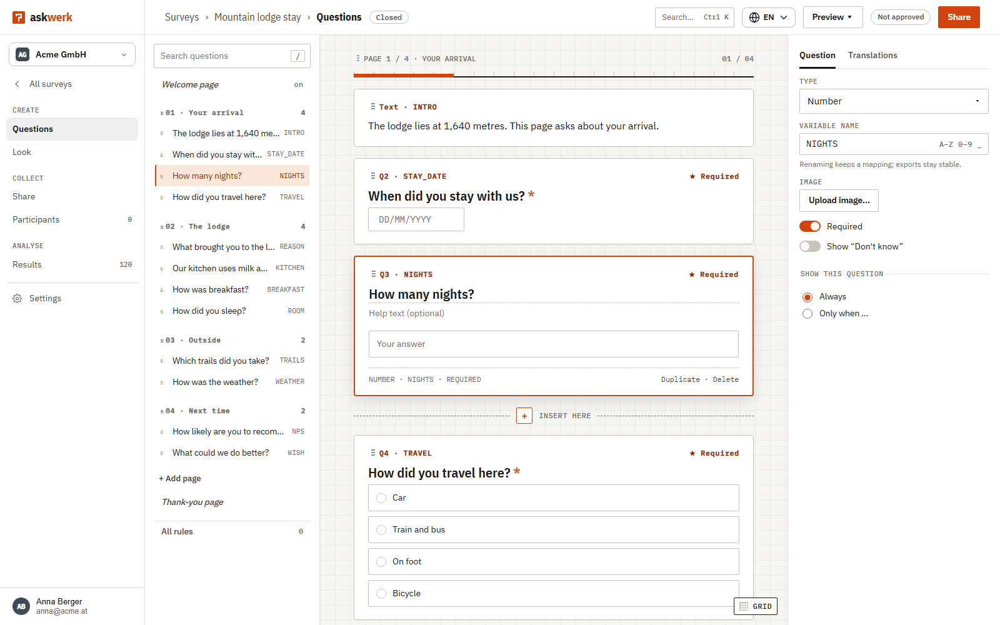
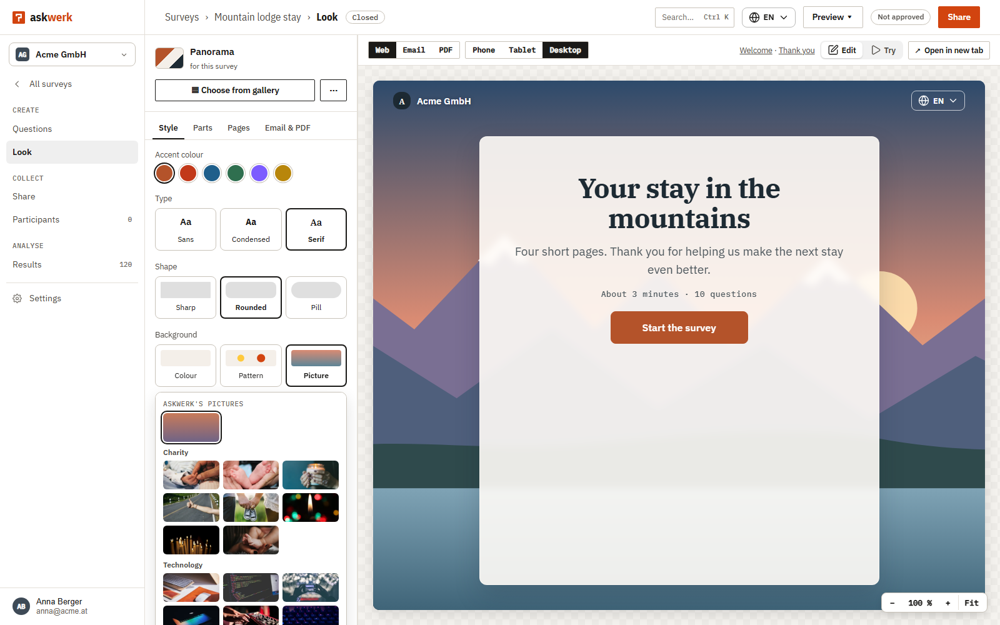
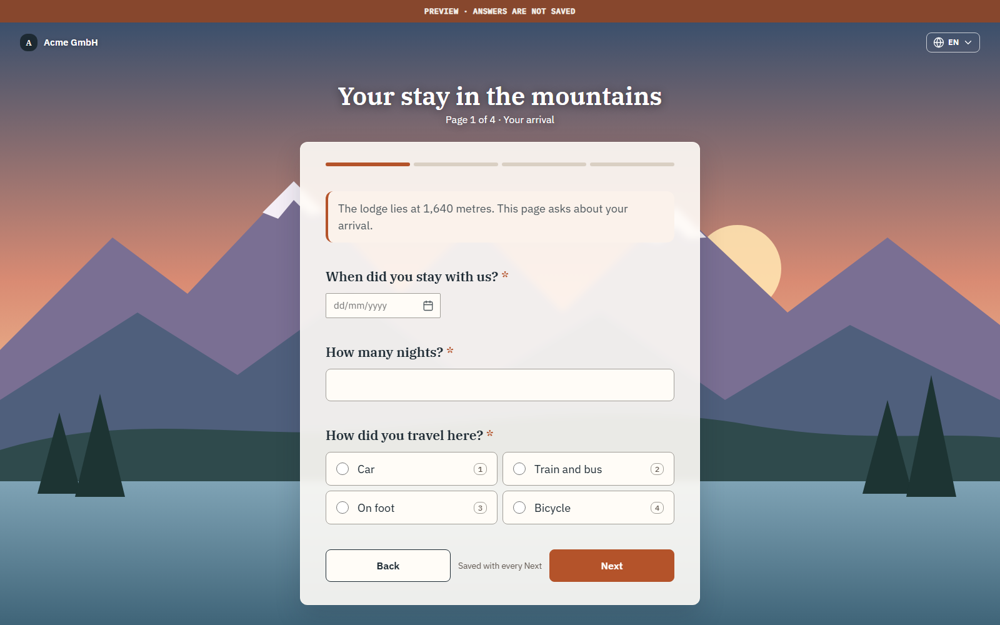
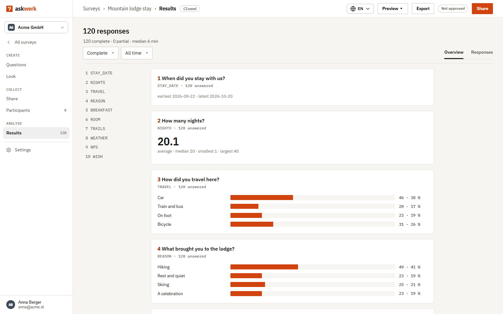

# Askwerk

A self-hostable survey platform for serious research and everyday feedback: deep enough for complex questionnaires, simple enough for anyone to build one, and open to the tools you already use.

> **Status: early development.** Askwerk is not ready for production use yet. Nothing below is guaranteed to work until the first release.

<table>
  <tr>
    <td width="50%"><br><sub><b>Designer.</b> Outline, canvas and inspector: write the survey where it shows.</sub></td>
    <td width="50%"><br><sub><b>Look.</b> Colours, type, shape and a background picture, with a live preview.</sub></td>
  </tr>
  <tr>
    <td width="50%"><br><sub><b>For respondents.</b> A fast, accessible page in the survey's own look.</sub></td>
    <td width="50%"><br><sub><b>Results.</b> An overview per question as the answers come in, and every response.</sub></td>
  </tr>
</table>

## What it does
- **Designer**: build surveys in a three-pane editor (outline, canvas, inspector) with inline editing and logic (show, hide, skip, jump, piping, quotas).
- **Respondent app**: a small, fast, accessible app (WCAG 2.2 AA) in two layouts: classic form, or one question at a time.
- **German and English** throughout, and survey texts in any language.
- **Publish to your own domain** in one screen: a free system subdomain, custom domains with automatic certificates, QR code, embed snippet.
- **Import and export**: LimeSurvey, Qualtrics, CSV and Excel in; CSV, Excel, SPSS and Stata out.
- **Integrate with your tools**: sign in through your own system (hand-over token, OpenID Connect, LDAP), sync users and contacts, embed the designer and the surveys in your product, and pull results into your own database on a schedule. All of it is opt-in per organisation.
- **Extend through the API**: everything the app does is available through a versioned Public API, with webhooks, SDKs for TypeScript, C# and Python, and an MCP server for AI assistants.

## Install in 10 minutes
Requirements: Docker with Compose v2, 2 GB of free RAM.

```bash
git clone https://github.com/civauva/Askwerk.git
cd Askwerk/deploy
cp .env.example .env            # secrets only; blank values are generated on first start
docker compose up -d            # Askwerk + PostgreSQL; add --profile caddy for automatic HTTPS
```

Then open <http://localhost:8080>. The setup wizard asks for the first admin account, the instance name and the base domain. Everything else is configured in the app; you never edit a config file.

Until the first release publishes images, build them locally instead of pulling: `docker compose up -d --build`. No registry is needed.

## Upgrade, back up, restore
```bash
docker compose pull && docker compose up -d     # migrations run automatically
../bin/backup.sh                                # database and files volume
../bin/restore.sh <backup-file>
```

## Run behind your own proxy
Askwerk serves plain HTTP on port 8080 and works behind any reverse proxy (nginx, Traefik, a cloud load balancer). The optional Caddy profile issues certificates automatically, including for your customers' own domains; with another proxy, certificates are your proxy's job.

## Integrate
The Public API, webhooks, embed events, SDKs and the MCP server are documented in [`docs/api/`](docs/api/). Example integrations are in [`docs/integrations/`](docs/integrations/).

## Develop
Prerequisites: .NET 10 SDK, Node.js 24 (pnpm comes through `corepack`), and Docker (or an existing PostgreSQL 16 via `ASKWERK_TEST_DB`, an owner connection string).

```bash
bin/test-all.sh
```

Askwerk is built strictly test-first. Read [CONTRIBUTING.md](CONTRIBUTING.md) before opening a pull request; the full rulebook for contributors and coding agents is in [`agents/`](agents/AGENTS.md).

## Licence
The product is licensed under the [GNU Affero General Public License v3.0](LICENSE). Everything an integrator builds into their own system (survey schema, embed script, SDKs, API description, examples) is licensed under the Apache License 2.0. Details in [LICENSING.md](LICENSING.md).

## Security
Please report vulnerabilities privately, as described in [SECURITY.md](SECURITY.md).
